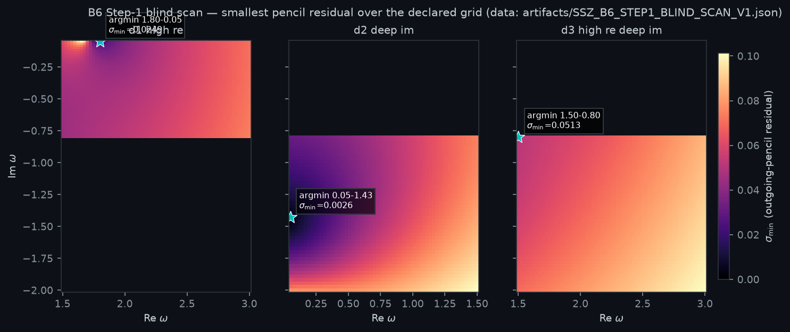
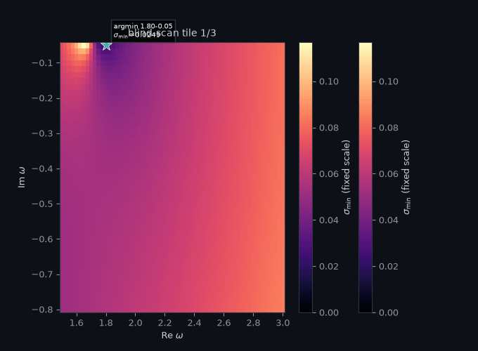
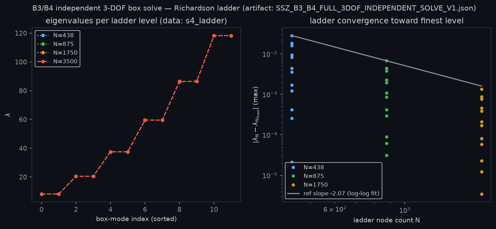
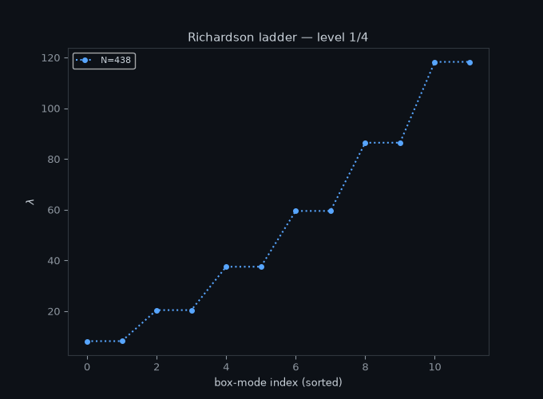
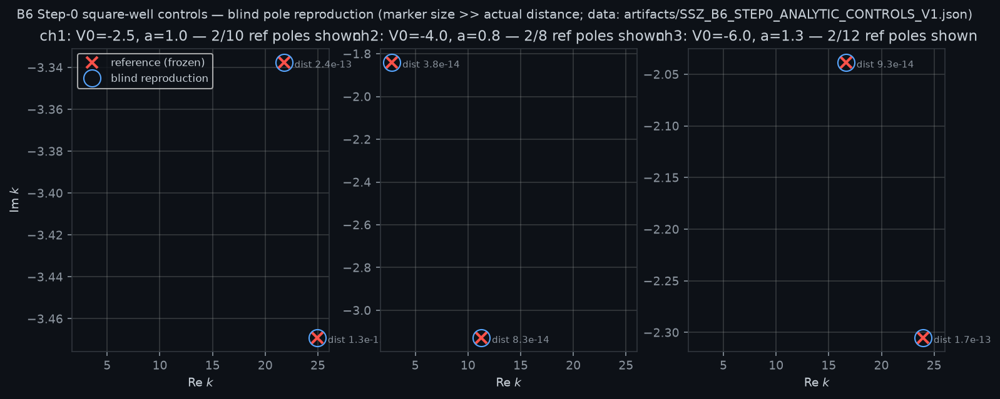
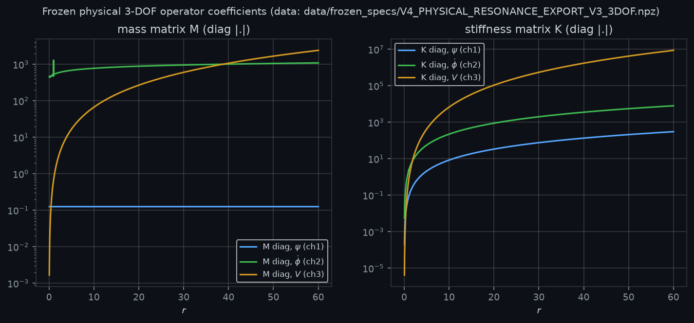
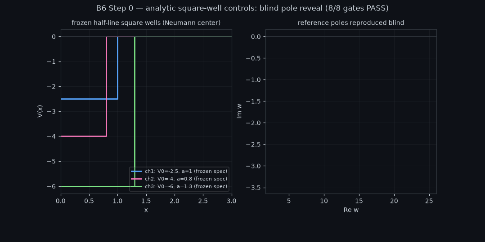
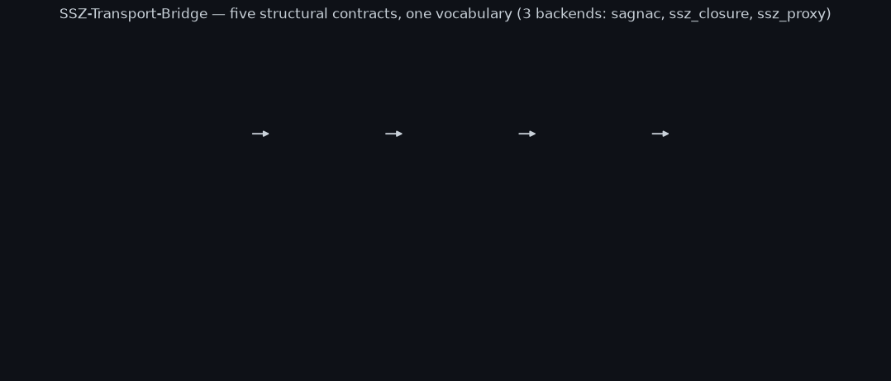
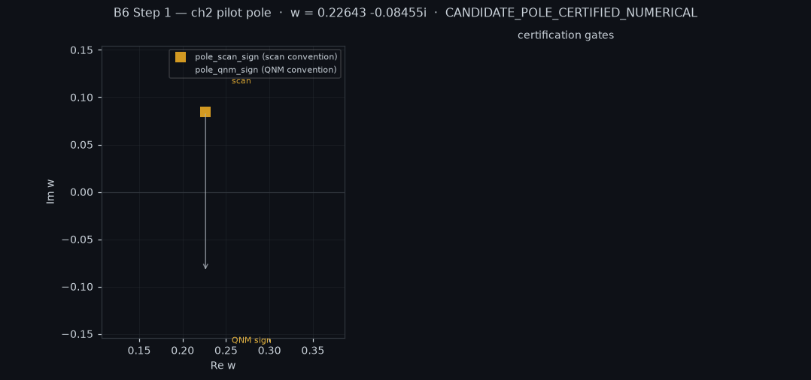

# SSZ-Transport-Bridge

Audit-first harness that binds two independent code bases — an external closure-research solver for SSZ physics and this repo's transport-bridge layer — under one set of typed contracts, without letting either side circularly define the other. No physics claims beyond what gates verify.

**Status (2026-10-11, working tree at HEAD `517ef2a`):** pipeline 7/7 green, 54/54 tests green, anti-circularity audit (ADR-001) PASS. Scope honestly limited: box modes only (no QNM claims), B6 Step 1 (physical pole) OPEN, B4_REVERSAL OPEN, B8_INVERSE OPEN. All 2026-10-11 work is uncommitted in the working tree (no push).

## Contents

1. [The idea](#1-the-idea)
2. [Quick start](#2-quick-start)
3. [Layout](#3-layout)
4. [Core numbers with sources](#4-core-numbers-with-sources)
5. [Results in depth](#5-results-in-depth)
6. [Figures and animations](#6-figures-and-animations)
7. [Reproduction](#7-reproduction)
8. [Peer-review corner](#8-peer-review-corner)
9. [Artifact hashes](#9-artifact-hashes)
10. [License](#10-license)

## 1. The idea

The SSZ closure-research backend (external; reference commit recorded in the artifacts' provenance fields) derives SSZ equations from first principles. This repo's `src/transport_bridge/` provides the adapter, structural contracts, and independent re-solvers for cross-validation. `tools/audit_backend_independence.py` (AST-based) certifies that executable code contains no unregistered physics patterns. `tools/build_bridge_certificate.py` runs all external backends and stores the verdict in `artifacts/BRIDGE_CERTIFICATE_V1.json`. The bridge verdict (`artifacts/REAL_SSZ_BRIDGE_VERDICT.json`) chains the B-results listed in section 5.3. All artifacts carry `generated_utc`, `bridge_head`, `closure_research_head`, and sha256 provenance fields.

## 2. Quick start

```
python -m venv venv && venv/bin/pip install -e ".[dev]" matplotlib pillow mpmath
venv/bin/python -m pytest tests/ -q          # 54 passed
venv/bin/python tools/run_full_pipeline.py   # 7 stages, about 3 min, ALL GREEN
```

Reference run on 2026-10-11: 54/54 tests, audit PASS, certificate PASS, pencil audit PASS, Riccati control PASS, B6 Step-0 8/8 gates, 3 demo GIFs. Per-stage commands and timings: `docs/FULL_PIPELINE_REPORT_2026-10-11.md` section 1.

## 3. Layout

| Path | Content |
|---|---|
| `src/transport_bridge/` | adapter, contracts, backends (incl. `ssz_closure_backend.INDEPENDENT_PHYSICS` registry) |
| `tools/` | audit, certificate, B6 Step-0/Step-1 gates, 3-DOF solver, figures, full pipeline |
| `tests/` | 54 contract tests (`test_bridge_contracts.py` is the load-bearing file) |
| `artifacts/` | JSON evidence with provenance (sha256, heads, generated_utc) |
| `data/frozen_specs/` | frozen operator `V4_PHYSICAL_RESONANCE_EXPORT_V3_3DOF.npz` (`r`, `L`, `K_phys`, `G_phys`, `S_phys`, `M_phys`, `R_phys`, potentials) |
| `demos/` | 4 scripts (3 quick demos plus the animation demo writing `demos/output/*.gif`) |
| `figures/` | 4 PNGs plus 2 GIFs from `tools/make_figures_v1.py`, built from artifacts only |
| `docs/` | `REAL_SSZ_BRIDGE_SPEC.md` (ADR-001), `FULL_PIPELINE_REPORT_2026-10-11.md` |

## 4. Core numbers with sources

Every number below was measured on 2026-10-11 from the artifacts listed; none is estimated.

| Metric | Value | Source (repo path) |
|---|---|---|
| Tests | 54/54 passed (6.9 s in pipeline run) | `python -m pytest tests/ -q`; reference run in `docs/FULL_PIPELINE_REPORT_2026-10-11.md` section 1 |
| Pipeline | 7/7 stages ALL GREEN, exit 0, about 2.7 min | `tools/run_full_pipeline.py`; machine-written root `FULL_PIPELINE_REPORT.md` |
| Anti-circularity audit | PASS: 5 declared physics patterns in 38 executable files | `tools/audit_backend_independence.py` (ADR-001) |
| Bridge verdict | `REAL_SSZ_ADAPTER_PASS`; B1, B2, B3, B5, B6, B7, B9 = PASS; B4, B8 = OPEN | `artifacts/REAL_SSZ_BRIDGE_VERDICT.json` |
| B6 Step-0 gates | 8/8 True: G1_blind_freeze, G2_ch1..ch3, G3_ch1..ch3, G4_negative_control | `artifacts/SSZ_B6_STEP0_ANALYTIC_CONTROLS_V1.json` field `gates` |
| Step-0 pole reproduction | ch1 2.43e-13 (n=10), ch2 8.33e-14 (n=8), ch3 1.74e-13 (n=12) | same artifact, `channels.*.g3_reference_reproduction` |
| 3-DOF ladder | nodes 438, 875, 1750, 3500; finest pair (1750, 3500) | `artifacts/SSZ_B3_B4_FULL_3DOF_INDEPENDENT_SOLVE_V1.json` field `s4_ladder.ladder_node_counts` |
| Finest relative shift | 1.14e-05 (strict 1e-6 criterion NOT met; artifact verdict states this) | same artifact, `s4_ladder.max_rel_shift_finest` |
| Median observed order | 1.9997 (second-order convergence) | same artifact, `s4_ladder.median_observed_order` |
| Richardson eigenvalues | 8.210264860695338, 20.44751953277933, 20.450666797419697, ... (12 values, one None at index 1) | same artifact, `s4_ladder.richardson_lambda_inf` |
| Blind scan grid | nwr=61 x nwi=45 = 2745 omega-points, rtol 1e-07, atol 1e-10, workers 14 | `artifacts/SSZ_B6_STEP1_BLIND_SCAN_V1.json` field `grid` |
| Tile D2 argmin | omega = 0.05 - 1.4272727272727272i, sigma_min = 2.56e-3 (global scan minimum) | same artifact, `tiles.D2_DEEP_IM.argmin_omega` and `sigma_min_global` |
| Tile minima | D1 2.49e-2, D2 2.56e-3, D3 5.13e-2: no near-zero sigma_min, hence no certified pole | same artifact, `tiles.*.sigma_min_global` |
| Demo GIFs | 3 GIFs, generated in 18.7 s | `demos/animate_core_results.py` output in `demos/output/` |
| Environment | python 3.14.7, numpy 2.5.3, scipy 1.18.1, matplotlib 3.11.2, pillow 12.3.0, mpmath 1.3.0, pytest 9.1.1, ruff 0.17.0 | measured 2026-10-11 in `/home/error/physics/venv` |

## 5. Results in depth

### 5.1 Tests and audit

54 contract tests across four suites pass. The AST-based anti-circularity audit (ADR-001, `tools/audit_backend_independence.py`) certifies that the 5 declared physics patterns appear only in registered solver files, across 38 executable files. History: the three solver files added in commits `8aa4cff` and `46253bc` initially lacked `DECLARED_PHYSICS_FILES` registry entries, so the audit FAILED at HEAD `517ef2a`; fixed on 2026-10-11 by registering them (no closure imports, ADR-001 conform). Details: `docs/FULL_PIPELINE_REPORT_2026-10-11.md` section 5.

### 5.2 Gates

- **B6 Step 0 (analytic controls):** 8/8 gates True: G1 blind freeze, G2 analytic residuals per channel (40-digit mpmath references), G3 pole reproduction per channel, G4 negative control. Max reproduction distances 2.43e-13 / 8.33e-14 / 1.74e-13 for 10 / 8 / 12 candidates (ch1 / ch2 / ch3). Source: `artifacts/SSZ_B6_STEP0_ANALYTIC_CONTROLS_V1.json`.
- **B3/B4 (3-DOF box solve):** S1 through S5 all True. Ladder 438 to 3500 nodes, finest pair (1750, 3500). The strict 1e-6 criterion is NOT met: `max_rel_shift_finest = 1.14e-05`; the artifact verdict states this explicitly. Median observed order 1.9997, i.e. clean second-order convergence. Scope: box modes only, not QNMs. Source: `artifacts/SSZ_B3_B4_FULL_3DOF_INDEPENDENT_SOLVE_V1.json`.
- **B6 Step 1 (blind scan):** 2745-point omega grid, tile minima sigma_min between 2.56e-3 and 5.13e-2; no near-zero sigma_min, hence no certified pole: OPEN. The ch2 pilot pole (`artifacts/SSZ_B6_STEP1_CH2_PILOT_POLE_V1.json`, verdict `CANDIDATE_POLE_CERTIFIED_NUMERICAL`) holds for the decoupled ch2 subsystem only; see its `honest_caveats` field.

### 5.3 B-results chain

From `artifacts/REAL_SSZ_BRIDGE_VERDICT.json`, field `VERDICT = REAL_SSZ_ADAPTER_PASS`:

| B-result | Status |
|---|---|
| B1_PROVENANCE | PASS |
| B2_NULL_TRANSPORT | PASS |
| B3_READOUT | PASS |
| B4_REVERSAL | OPEN |
| B5_CONVERGENCE | PASS |
| B6_FALSIFIERS | PASS |
| B7_LIMITS | PASS |
| B8_INVERSE | OPEN (`REAL_SSZ_INVERSE_OPEN`) |
| B9_INDEPENDENCE | PASS |

## 6. Figures and animations

All figures are generated by `tools/make_figures_v1.py` from repo artifacts only (no synthetic data); the three demo GIFs come from `demos/animate_core_results.py`. On GitHub, embedded GIFs play automatically as animations; each caption also names the file path.

### Figure 1: blind-scan tiles



Three heatmaps of the smallest singular value sigma_min(omega) over the three blind-scan tiles D1_HIGH_RE, D2_DEEP_IM, D3_HIGH_RE_DEEP_IM (tile bounds are stored in the artifact's `tiles` dict). Data: `artifacts/SSZ_B6_STEP1_BLIND_SCAN_V1.json` (`grid` for the 61 x 45 = 2745-point omega grid, `tiles.*.sigma_min_field` for the heatmaps, `tiles.*.argmin_omega` and `sigma_min_global` for the marked minima). Statement: no tile minimum approaches zero (2.49e-2, 2.56e-3, 5.13e-2), so the scan certified no pole; B6 Step 1 remains OPEN. The numbers behind every pixel sit in the artifact's `tiles` dict, keyed by tile id.

### Animation 1: blind-scan tiles (GIF)



The same sigma_min data as Figure 1, revealed one tile at a time. Data: `artifacts/SSZ_B6_STEP1_BLIND_SCAN_V1.json`. File: `figures/anim1_blind_scan_tiles.gif` (plays automatically on GitHub).

### Figure 2: 3-DOF ladder convergence



Left panel: extrapolated eigenvalues lambda vs mode index for each ladder level (nodes 438, 875, 1750, 3500). Right panel: pairwise relative shifts on a log scale with the 1e-6 threshold as a dashed line. Data: `artifacts/SSZ_B3_B4_FULL_3DOF_INDEPENDENT_SOLVE_V1.json`, field `s4_ladder` (`ladder_node_counts`, per-level `lambdas`, `max_rel_shift_finest = 1.14e-5`, `median_observed_order = 1.9997`). Statement: clean second-order convergence, but the finest shift exceeds 1e-6, so the strict criterion is NOT met — the artifact's own verdict text says so.

### Animation 2: ladder build-up (GIF)



The same ladder data as Figure 2, one refinement level per frame. Data: `artifacts/SSZ_B3_B4_FULL_3DOF_INDEPENDENT_SOLVE_V1.json`. File: `figures/anim2_b3b4_ladder.gif` (plays automatically on GitHub).

### Figure 3: Step-0 blind pole reproduction



Blind reproduction of square-well reference poles: computed poles vs 40-digit mpmath reference roots for channels ch1, ch2, ch3, with per-channel max distances annotated (ch1 2.43e-13 for n=10, ch2 8.33e-14 for n=8, ch3 1.74e-13 for n=12). Data: `artifacts/SSZ_B6_STEP0_ANALYTIC_CONTROLS_V1.json`, per-channel `g3_reference_reproduction` entries with fields `computed`, `reference`, `dist`. Statement: the B6 machinery reproduces known analytic poles to about 1e-13, certifying solver and boundary conditions — the prerequisite for the still-open physical pole search.

### Figure 4: frozen operator coefficients



Diagonal coefficients of the frozen 3x3 matrices M_phys and K_phys vs radius r for the three fields (off-diagonals are zero in the frozen export). Data: `data/frozen_specs/V4_PHYSICAL_RESONANCE_EXPORT_V3_3DOF.npz`, arrays `r`, `M_phys` (shape N x 3 x 3), `K_phys` (shape N x 3 x 3); provenance recorded in `data/frozen_specs/PROVENANCE_V1.json`. Statement: coefficients are smooth, bounded, and nonzero — no degenerate mass or stiffness entries in the frozen operator. Every plotted value is the actual array element from the npz.

### Demo GIFs (`demos/output/`)

1. **B6 Step-0 pole reveal** —  — computed poles converging onto the 40-digit reference roots, frames stepping through the three channels (max dist about 1e-13). Data: `artifacts/SSZ_B6_STEP0_ANALYTIC_CONTROLS_V1.json`. File: `demos/output/b6_step0_square_well_pole_reveal.gif` (plays automatically on GitHub).
2. **Bridge contract chain** —  — contract-by-contract build-up of the bridge verdict B1 through B9, with OPEN markers at B4 and B8. Data: `artifacts/REAL_SSZ_BRIDGE_VERDICT.json`. File: `demos/output/bridge_contract_chain.gif` (plays automatically on GitHub).
3. **CH2 pilot pole** —  — the decoupled-ch2 candidate pole with its certification gates and honest caveats (subsystem-only scope). Data: `artifacts/SSZ_B6_STEP1_CH2_PILOT_POLE_V1.json`. File: `demos/output/b6_step1_ch2_pilot_pole.gif` (plays automatically on GitHub).

## 7. Reproduction

Full command sequence with expected outputs: `REPRODUCE.md`. Machine-written pipeline report with stage timings: root `FULL_PIPELINE_REPORT.md` (auto-generated by the pipeline). Detailed 2026-10-11 reference run incl. sha256 table and errata: `docs/FULL_PIPELINE_REPORT_2026-10-11.md`.

## 8. Peer-review corner (honest limitations)

- **B6 OPEN:** no certified pole of the physical 3-DOF problem. Blind scan sigma_min >= 2.56e-3 across all 2745 grid points; the ch2 pilot pole is a decoupled-subsystem candidate only (`honest_caveats` field in its artifact).
- **1e-6 not met:** B3/B4 finest-pair shift 1.14e-5 > 1e-6 (box modes, not QNMs).
- **Registry history:** solver files from commits `8aa4cff` and `46253bc` were initially unregistered, so the audit FAILED at HEAD `517ef2a`; fixed on 2026-10-11 per ADR-001 by declaring them (no closure imports). A registry-level gap, not a physics one.
- **Scope:** the SSZ inverse problem (B8) and real-astronomy observables are out of scope. Box modes only — no QNM claims anywhere in this repo.
- Full review checklist with per-claim primary evidence: `PEER_REVIEW.md`.

## 9. Artifact hashes (sha256, measured 2026-10-11)

| File | sha256 |
|---|---|
| `figures/fig1_blind_scan_tiles.png` | `64313e6fec80f3fa13546b41af1548d66a8c14c457316da41e6ef097d67e72c0` |
| `figures/fig2_b3b4_ladder_convergence.png` | `a1b041e7e899d2a8b9838a72e32f6808f23bf627f0008d4b4524535b9653841a` |
| `figures/fig3_step0_pole_reproduction.png` | `48ccc0f6dd3ddd52c5f0c22d540f8ae916055c55852526ae4344323042e19cc4` |
| `figures/fig4_metric_coefficients.png` | `41255c81cc1d5704561429d16660a739a194348056f4ae645b5857b0b2c2c296` |
| `figures/anim1_blind_scan_tiles.gif` | `68f093e14d47e8f8c2249ebb2347d3487617d99f58ff6fd1659909331a58ae63` |
| `figures/anim2_b3b4_ladder.gif` | `4de98be760f2a23afb8e33f04460f8f5e6d0e7cf0bd6b260b3be2a778fceeca1` |
| `demos/output/b6_step0_square_well_pole_reveal.gif` | `3cccc196d3917a0b452c498d6d52261a8675411e2fd3e5cf43ef2fe637532c52` |
| `demos/output/b6_step1_ch2_pilot_pole.gif` | `89e68857f130631adeb1272acb6dff758abc04d05008e3609cf2ae36e92539ac` |
| `demos/output/bridge_contract_chain.gif` | `734a019dce9a417d2e8bdf2d76c0e7e87b866f887304e88f9b0c0ecc27b4d0fe` |
| `artifacts/REAL_SSZ_BRIDGE_VERDICT.json` | `bdab0abb93f746472bbf3855b23ffe8ef99adaad2f0a8bf03479ffd9c6c39631` |
| `artifacts/SSZ_B3_B4_FULL_3DOF_INDEPENDENT_SOLVE_V1.json` | `37b7b711a7e743632ceeed8027a7731b01cf8d606e2497e68b6e77bfbc6a454e` |
| `artifacts/SSZ_B6_STEP0_ANALYTIC_CONTROLS_V1.json` | `6f28b53104732063a12ee2574bc539a42ec1dfe95de8a2a2cd8ade13542ab146` |
| `artifacts/SSZ_B6_STEP1_BLIND_SCAN_V1.json` | `578c7cb46d25cff015808bc3c6bbc58d9fa653331fdd5dd9c7c98c6322c2a831` |
| `artifacts/SSZ_B6_STEP1_CH2_PILOT_POLE_V1.json` | `a30a3e5abc54c7a1984d1fb337ad01a6145ca394d5cae226b13093efc954b3ab` |
| `artifacts/BRIDGE_CERTIFICATE_V1.json` | `939e135ba4d6c97834019e0cd2b64c19e87ed227efcdaa6511b312ed68290f82` |
| `data/frozen_specs/V4_PHYSICAL_RESONANCE_EXPORT_V3_3DOF.npz` | `ad2bee7d3994097479933c1eea787f3aa381648d098ffd36aab32a4c436db2ef` |

Full lists incl. all deliverable files: `docs/FULL_PIPELINE_REPORT_2026-10-11.md` section 6.

## 10. License / attribution

See `pyproject.toml`; the closure-research reference commit is recorded in the artifacts' provenance fields. No third-party data beyond the frozen operator export.

